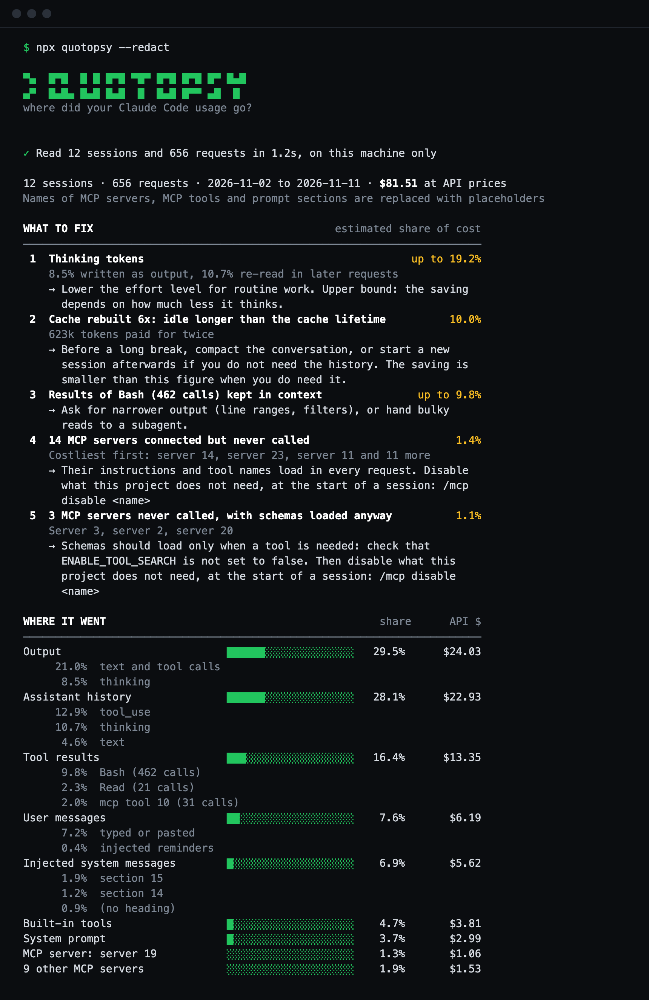

# Quotopsy

Shows where your Claude Code usage went, and what to fix.

```bash
npx quotopsy
```



It reads the session logs Claude Code already keeps on your machine and
estimates what each part of the context cost: tool schemas, system prompt, MCP
servers, tool results, history, output. Then it ranks what to fix, such as
cache rebuilds after idle gaps.

It also lists every connected MCP server with what it cost to keep connected
and to use, and marks the ones you never call.

- Local: no network calls, no LLM calls, no dependencies.
- One readable file: [quotopsy.mjs](quotopsy.mjs).
- Every figure is an estimate, and labelled as one.

## Options

Needs Node 20 or newer.

| Option | Effect |
| --- | --- |
| `[logs-dir]` | Logs to read. Defaults to `~/.claude/projects`. |
| `--since=DAY` | Only usage from that day on: `YYYY-MM-DD`, or days back such as `7d`. |
| `--until=DAY` | Only usage up to the end of that day. |
| `--json` | Print the summary as JSON. |
| `--redact` | Replace MCP server names, MCP tool names and prompt headings with placeholders. |
| `--debug` | With `--json`, add structure-only diagnostics. No message text. |
| `--doctor` | Print a short diagnostic to paste into an issue: versions, counts and sizes. No names, paths or text. |
| `--version` | Print the version. |

Days are read in your local time zone.

## Did a change help?

Compare the period before it with the period after:

```bash
npx quotopsy --until=2026-11-10
npx quotopsy --since=2026-11-11
```

## Check it yourself

To enforce "read these logs, no network" instead of trusting the code:

```bash
deno run --allow-read=$HOME/.claude --deny-net quotopsy.mjs $HOME/.claude/projects
```

## Share a summary

```bash
npx quotopsy --json --redact --debug > summary.json
```

The file holds token totals, counts, timestamps and model names. No prompts,
code, file paths or tool output.

## Something looks wrong?

The report ends with a health line that says when its figures deserve less
trust. To report a problem, paste the output of this into
[an issue](https://github.com/Impakt-Dot-Dev/quotopsy/issues):

```bash
npx quotopsy --doctor
```

The tool never sends anything itself. You choose what to share.

## Limits

- Sees only sessions that ran on this machine. Cloud sessions count against
  the same limits but leave no logs here.
- Needs Claude Code 2.1.300 or newer to attribute usage. Older logs show as
  "unattributed", though cache rebuilds after idle gaps are still found.
- Costs are weighted at published API prices (checked 2026-11-10). How plan
  limits weight token types and models is not published.
- A model missing from the price table is priced like the newest model of its
  family, and the report says so.

## Tests

`npm test`. The tests build synthetic logs and never read real ones.

## License

[MIT](LICENSE)
